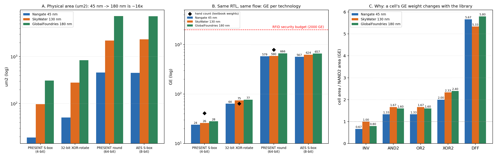

# Gate Equivalents of Lightweight-Crypto Blocks: Hand Count vs Real Synthesis

**Course:** Lightweight Cryptography (CRYE6135), Centre for Cybersecurity and Mathematical Cryptology, University of Bamenda
**Assignment:** Session 2 (Target Devices and Performance Metrics), Project 2
**Group:** _add names here_

## What this project does

The assignment asks us to estimate the area of a small crypto design by hand, synthesise it in at least two technologies, compute its gate equivalents (GE), and explain why GE numbers from different technologies must not be compared directly.

One GE is the area of a two-input NAND gate: `GE = design area / NAND2 area`, using the NAND2 of the same library.

We did this for four designs:

| Design | What it is |
|---|---|
| PRESENT S-box | the 4-bit S-box, as a truth table |
| PRESENT round | AddRoundKey + 16 S-boxes + pLayer (64-bit, combinational) |
| 32-bit XOR-rotate | `Y = (A ^ B) <<< 7` |
| AES S-box (bonus) | the 8-bit S-box as a plain lookup table, as a reference point |

and on three **real** open-source standard-cell libraries (not invented cell ratios):

| Technology | Library |
|---|---|
| 45 nm | Nangate Open Cell Library |
| 130 nm | SkyWater sky130 `sky130_fd_sc_hd` |
| 180 nm | GlobalFoundries `gf180mcu_fd_sc_mcu7t5v0` |

## Pipeline (all done by `run_project2.py`)

1. **Reference model.** A Python PRESENT-80 is checked against the 4 official test vectors, which validates the S-box table and the pLayer.
2. **Hand count.** A 31-gate S-box netlist is counted and simulated from the same gate list, so the count cannot drift from the design. Textbook weights are used: INV 0.67, NAND/NOR 1, AND/OR 1.33, XOR 2 GE.
3. **RTL check.** The Verilog in `rtl/` is driven with test vectors through Yosys and compared with the Python reference. The hand netlist is proven equal to the truth-table S-box.
4. **Synthesis.** Yosys + ABC map each design onto each real library. The cell areas come straight from the `.lib` files.
5. **Equivalence proof.** Every synthesised netlist is proven equivalent to its RTL with a SAT miter.
6. **Report.** Tables (CSV) and a 3-panel chart.

## Results (reference run)

Synthesis tool: Yosys `<fill in: output of yosys -V>`, default `abc -liberty` mapping.

| Design | Hand count | 45 nm | 130 nm | 180 nm |
|---|---|---|---|---|
| 32-bit XOR-rotate | 64 | 64.0 | 74.7 | 76.8 |
| PRESENT S-box (4-bit) | 41 | 24.0 | 26.0 | 28.2 |
| PRESENT round (64-bit) | 784 | 579.3 | 589.7 | 666.2 |
| AES S-box (8-bit LUT) | n/a | 566.7 | 624.3 | 657.4 |

GE weight of basic cells, read from the libraries:

| Technology | NAND2 (um2) | INV | AND2 / OR2 | XOR2 | DFF |
|---|---|---|---|---|---|
| Nangate 45 nm | 0.798 | 0.67 | 1.33 | 2.00 | 5.67 |
| SkyWater 130 nm | 3.754 | 1.00 | 1.67 | 2.33 | 5.33 |
| GlobalFoundries 180 nm | 10.976 | 0.80 | 1.60 | 2.40 | 5.80 |



### Findings

- Synthesis gives an S-box about 40% smaller than the hand count (about 24-28 GE against 41 GE).
- The pLayer and the rotation are pure wiring and cost 0 gates. `xor_rot32` maps to exactly 32 XOR cells.
- Physical area grows about 16x from 45 nm to 180 nm, while GE moves only 15-20%. GE removes most, but not all, of the technology effect.
- The remaining difference comes from the library: the same function costs a different number of GE because each library's cells have different area ratios to its NAND2 (for example XOR2 is 2.00, 2.33 and 2.40 GE). GE is only a fair comparison within one technology.
- The AES S-box as a plain lookup table is roughly 23-24x the PRESENT S-box. Optimised AES S-box designs are much smaller than this naive version.
- The round figures are combinational logic only. They exclude the state register (64 flip-flops, roughly 340-370 GE) and the key schedule.

Absolute GE values can differ by a few percent between Yosys/ABC versions (we saw 24.7 vs 24.0 GE for the S-box on two versions). The hand counts do not depend on the tool, and the conclusions hold either way.

## How to reproduce

You need Python 3.9+ and **a native Yosys**.

### Linux / WSL (Ubuntu, tested)

```bash
sudo apt install yosys python3-matplotlib python3-numpy
git clone <repo-url>
cd <repo-folder>
python3 run_project2.py
```

### macOS

```bash
brew install yosys
pip3 install -r requirements.txt
python3 run_project2.py
```

### Windows

Use WSL (`wsl --install`, then follow the Linux steps), or install the native Windows build from [OSS CAD Suite](https://github.com/YosysHQ/oss-cad-suite-build/releases) and put its `bin` folder on your PATH.

The pip package `yowasp-yosys` crashed in the ABC step on our Windows machine (Python 3.14, Yosys 0.59 and 0.70), so we do not recommend it. The script uses `yosys` if it is on PATH and falls back to `yowasp-yosys`.

### Optional: virtual environment

```bash
python3 -m venv .venv
source .venv/bin/activate        # Windows: .venv\Scripts\Activate.ps1
pip install -r requirements.txt
```

The first run downloads about 40 MB of cell libraries into `libs/`. After that it works offline.

## Notes

- The standard-cell libraries are downloaded at run time from the OpenROAD-flow-scripts repository and are not redistributed here. They keep their own licences.
- `results/` holds the reference run. Rerunning overwrites it.
